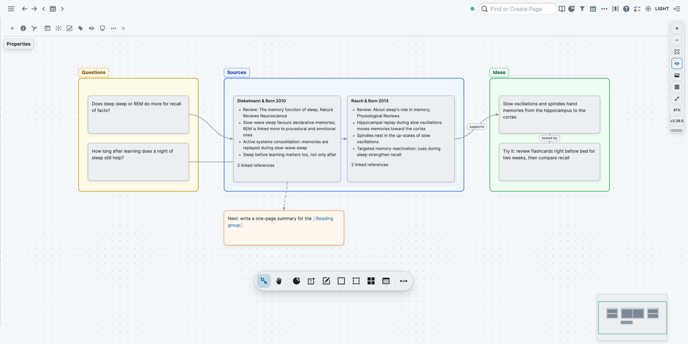
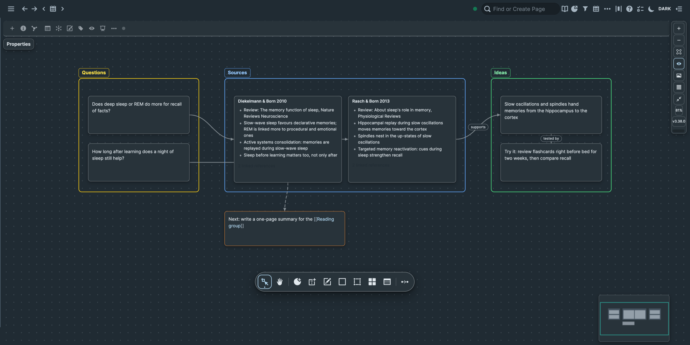
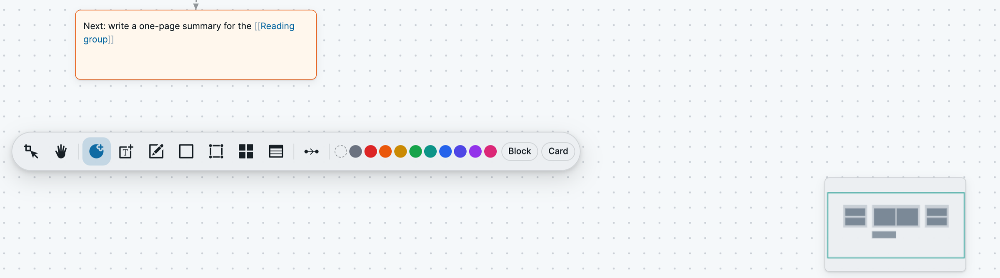

# Depot listing draft

This folder is the Roam Depot material for Plexus Diagram. Nothing here is read at runtime. The pull request against `Roam-Research/roam-depot` has not been opened.

## Description

Plexus Diagram is a whiteboard on a Roam `{{[[diagram]]}}` block. Cards, sections, and connections are ordinary blocks. A board or a section can follow a block's children, a query, linked references, a page's headings, journals, the Inbox, or another board. Graph links already in the graph draw as arrows. Restore native diagram hands the block back to Roam's own diagram view.

The product page Roam renders is the repository `README.md` at `source_commit`. The short line in the metadata file is the marketplace blurb.

## Screenshots

Taken on 3.38.0 in Roam Desktop (the board UI is unchanged in 3.39.0), on a scratch board in a test graph, with the light and the dark Roam theme. They are the README images in `docs/img/`. The README links them by full `raw.githubusercontent.com` address at the `v3.39.0` tag, because Roam Depot publishes only the README text, not the images beside it.







## Metadata

`extensions/Svyk/plexus-diagram.json` is the file a fork would place at `extensions/Svyk/plexus-diagram.json`.

| Field | Value |
|---|---|
| name | Plexus Diagram |
| author | Svyatoslav Kleshchev |
| source_url | https://github.com/Svyk/plexus-diagram |
| source_repo | https://github.com/Svyk/plexus-diagram.git |
| source_commit | `659f5b7eb341a40109008696ad6f22f7f03db060` |
| tags | diagram, whiteboard, canvas, blocks |

`source_commit` is `659f5b7`, the 3.39.0 release commit, tagged `v3.39.0` and kept on the branch `release/v3.39.0`. `main` holds the same code in the PXD-22 merge commit. It has Parse PDF on any block, the Depot build as one plain bundle with no eval, block menu items that show in a real install, and README images by full address.

## Pull request

Title: `Add Plexus Diagram`

Body:

```
Add extensions/Svyk/plexus-diagram.json.

Source: https://github.com/Svyk/plexus-diagram
Commit: 659f5b7eb341a40109008696ad6f22f7f03db060
```

Fork `Roam-Research/roam-depot`, copy the JSON to `extensions/Svyk/plexus-diagram.json`, and open that pull request only when you decide to. This draft does not do that.

## What the reviewer will build

`build.sh` runs `npm ci --ignore-scripts --no-audit --no-fund` and then `node build.mjs`. The repo root has `README.md`, `extension.js`, `extension.css`, `CHANGELOG.md`, and `LICENSE` (MIT). The package version is 3.39.0.

## Readiness check (3.39.0, 2026-11-07)

Checked against Roam's developer docs (Roam Depot/Extensions), the help page Roam Depot and the roam-depot build and publish scripts:

- Files: `README.md`, `extension.js`, `extension.css`, `CHANGELOG.md` and `LICENSE` (MIT) at the root; `build.sh` rebuilds `extension.js` byte for byte (`npm run verify:generated`).
- Metadata: name, short_description, author, source_url, source_repo (ends in .git) and source_commit are set; tags is optional.
- No remote code: the Depot build leaves out In-browser reading (beta) and the anydoc converter, and has no `eval`, `new Function`, `import()` or workers, so Roam should not mark it as using eval and admins can install it for a whole graph. The build fails if either comes back.
- Size: Roam sets no size limit, and the build and publish scripts check none. `extension.js` is 2.6 MB (0.9 MB gzipped) and `extension.css` 320 KB. Plexus bundles no npm packages and none of the libraries Roam exports.
- Settings panel through `extensionAPI.settings.panel.create`; no secrets in settings (API keys and the helper token stay in this browser).
- Clean unload: removing the extension leaves no Plexus elements, styles, classes, commands or globals, and native diagrams show again (checked live).

## Note for the reviewer

`extension.js` is one plain minified bundle built from this repository by `build.sh`. It does not use `eval`, `new Function`, dynamic `import()` or workers, and nothing is fetched. The GitHub Pages build (`deploy/extension.js`) keeps rarely used code as lazy pieces; the Depot build does not.
